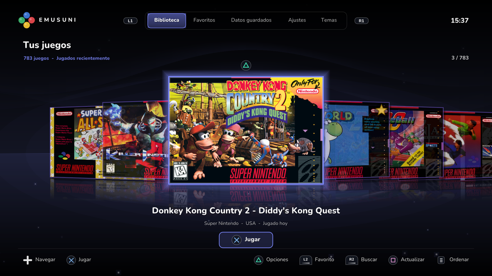
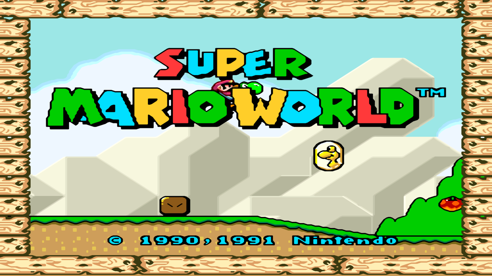
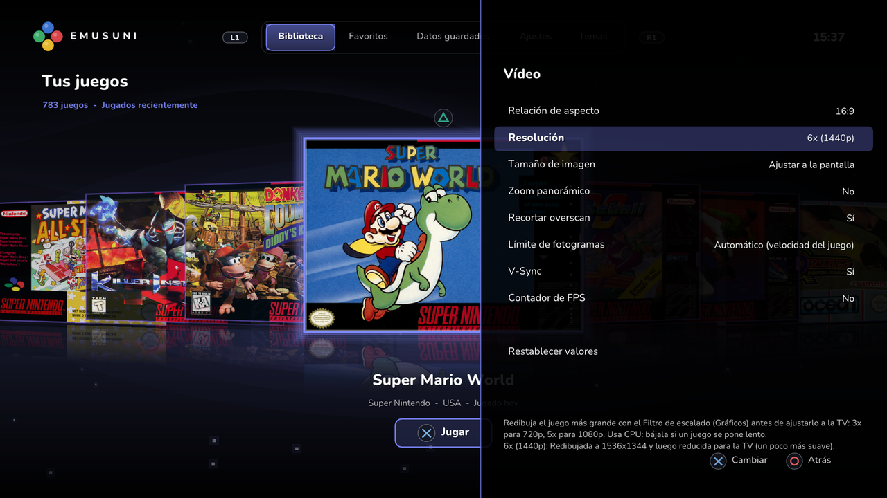
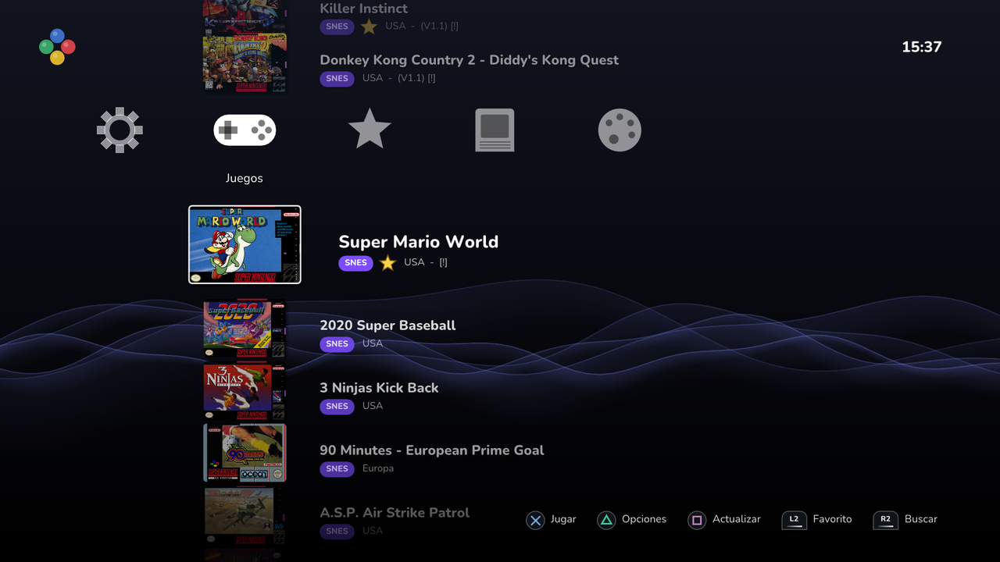

<p align="center">
  
</p>

<p align="center">
  <b>Super Nintendo, NES y Nintendo 64 para PS4 con jailbreak.</b><br>
  Tres consolas en un lanzador al estilo de una consola: carátulas automáticas, imagen HD con IA,
  niveles de calidad, marcos, favoritos, buscador y ajustes para cada juego.
</p>

<p align="center">
  <a href="https://github.com/arturofuentes1988/EmuSuNi/releases/latest"></a>
  
  
  <a href="LICENSE"></a>
</p>

<p align="center"><a href="README.md">Read in English</a> · <a href="CHANGELOG.md">Historial de cambios</a> · <a href="https://github.com/arturofuentes1988/EmuSuNi/releases/latest">Descargar</a></p>

---

## Capturas

<table>
  <tr>
    <td width="50%"></td>
    <td width="50%"></td>
  </tr>
  <tr>
    <td align="center"><b>Biblioteca</b> — tus juegos con sus carátulas, descargadas solas</td>
    <td align="center"><b>En el juego</b> — redibujado a 5x (1080p) con el filtro xBRZ</td>
  </tr>
  <tr>
    <td></td>
    <td></td>
  </tr>
  <tr>
    <td align="center"><b>Favoritos</b> — L2 sobre cualquier juego</td>
    <td align="center"><b>Buscador</b> — teclado en pantalla, resultados mientras escribes</td>
  </tr>
  <tr>
    <td></td>
    <td></td>
  </tr>
  <tr>
    <td align="center"><b>Ajustes</b> — cada opción explicada abajo</td>
    <td align="center"><b>Menú del juego</b> (L3 + R3) — estados guardados, ajustes, trucos</td>
  </tr>
  <tr>
    <td></td>
    <td></td>
  </tr>
  <tr>
    <td align="center"><b>Estilo XMB</b> — las columnas al estilo PSP, 12 temas de color</td>
    <td align="center"><b>Limpiar juegos</b> — repetidos y otras regiones</td>
  </tr>
</table>

## Características

**Emulación**
- **Snes9x 1.63** (la versión libretro) integrado en la app, con los chips SuperFX, SA-1, DSP y
  demás, y los modos de alta resolución y entrelazados.
- Partidas de batería guardadas solas, **8 ranuras de estado** con captura, *continuar donde lo
  dejaste*, **trucos** en formato `.cht` de RetroArch y el botón Reset de la consola.
- **Hasta 5 jugadores** con el Super Multitap y más mandos DualShock 4.

**Un lanzador como el de una consola**
- Dos estilos de menú: **Biblioteca** (carátulas en fila, pestañas con L1 / R1) y **XMB** (las
  columnas de la PSP), 12 temas de color o tus propios fondos, sonidos de 8 bits y melodía de
  inicio.
- **Carátulas automáticas**: las que faltan se descargan en segundo plano desde el servidor de
  libretro. Reconoce nombres GoodSNES y No-Intro (números romanos, subtítulos, orden de las
  palabras, letras de más o de menos); si un juego no tiene caja, usa su pantalla de título.
- Pestaña de **favoritos**, **buscador** con teclado en pantalla, orden (A–Z, jugados
  recientemente, región) y un juego predeterminado que se inicia solo.
- **Gestión de juegos**: explorador de carpetas (almacenamiento interno o USB), *borrar un juego*
  y *Limpiar juegos* (borrar repetidos, dejar solo juegos USA; antes se muestra la lista completa).
- **13 idiomas**.

**Imagen**
- **Resolución** 2x–6x (**5x para 1080p**) con los filtros **xBRZ**, **HQx** o **Píxeles
  nítidos**, en varios hilos (3–6 ms por fotograma a 6x, medido en una PS4).
- Relación de aspecto (4:3, píxel perfecto 8:7, 16:9, estirada), escala entera, zoom, recorte de
  overscan, filtrado nítido o suave, scanlines, **filtro NTSC** de blargg (compuesto, S-Video, RGB,
  RF), mezcla de alta resolución, menos parpadeo de sprites, V-Sync.

**Rendimiento y sistema**
- Overclock de la CPU y del SuperFX, velocidad de emulación, **avance rápido** (R2), salto de
  fotogramas, contador de FPS y gráficos de rendimiento.
- Interpolación de audio (gaussiana como la consola, cúbica, sinc...), búfer de audio, volumen.
- **Cada ajuste para todos los juegos o para uno**, con una breve descripción de cada ajuste y de
  cada una de sus opciones.
- **Botones configurables**, para todos los juegos o para uno.

## Requisitos

- Una PS4 con **[GoldHEN](https://github.com/GoldHEN/GoldHEN)** (cualquier modelo).
- Tus propios juegos:
  - Super Nintendo: `.sfc`, `.smc`, `.swc`, `.fig`, `.bs` o `.zip`.
  - NES: `.nes`, `.fds`, `.unf` o `.zip`.
  - Nintendo 64: `.z64`, `.n64` o `.v64` (en el pendrive, carpeta `Roms/n64`; se puede cambiar).
- Internet en la PS4 para las carátulas (opcional).

## Instalación

1. Descarga **`EmuSuNi-vXX.YY.pkg`** desde la [última versión](https://github.com/arturofuentes1988/EmuSuNi/releases/latest).
2. Cópialo a un pendrive (FAT32 o exFAT), por ejemplo en una carpeta `PKG`.
3. En la PS4, instálalo con el **Package Installer** de GoldHEN (o *Ajustes → Debug Settings →
   Game → Package Installer*).
4. Abre **EmuSuNi** desde la pantalla de inicio.

Para actualizar, instala el paquete nuevo encima del anterior: tus ajustes, partidas y carátulas
se quedan en `/data/EmuSuNi`.

## Primeros pasos

1. Pon tus juegos en `/data/EmuSuNi/games` (por FTP) o en cualquier carpeta de un pendrive, y
   elígela en **Ajustes → Carpeta de juegos**. También se buscan las subcarpetas.
2. Las carátulas se descargan solas la primera vez (el avance se ve bajo *Tus juegos*).
3. Pulsa **Cruz** para jugar. En el juego, **L3 + R3** (los dos sticks presionados) abre el menú.

## Controles

| Menú (estilo Biblioteca) | |
|---|---|
| Cruceta izquierda / derecha | Juego anterior / siguiente (arriba / abajo: de 10 en 10) |
| L1 / R1 | Pestañas: Biblioteca, Favoritos, Datos guardados, Ajustes, Temas |
| Cruz | Jugar / elegir |
| Triángulo | Opciones del juego: favorito, ajustes, trucos, controles, información, juego predeterminado, borrar |
| L2 | Añadir a favoritos / quitar |
| R2 | Buscar (teclado en pantalla) |
| Cuadrado | Leer de nuevo la carpeta de juegos |
| Options | Ordenar: A–Z, jugados recientemente, región |
| Círculo | Volver (en una búsqueda: borrarla) |

| Teclado del buscador | |
|---|---|
| Cruz | Escribir la tecla |
| Cuadrado / Triángulo | Borrar una letra / espacio |
| L2 | Borrar todo |
| L1 / R1 | Recorrer los juegos encontrados sin cerrar el teclado |
| R2 | Listo |
| Círculo | Cerrar el teclado |

| En el juego (controles predeterminados) | |
|---|---|
| Cruz / Círculo / Cuadrado / Triángulo | B / A / Y / X de la SNES |
| L1 / R1 | L / R de la SNES |
| Options / panel táctil | Start / Select |
| Cruceta o stick izquierdo | Cruceta |
| R2 (mantener) | Avance rápido |
| L3 + R3 | Menú del juego |

Mantén **L1** al abrir EmuSuNi para ir al menú en vez del juego predeterminado.

## Ajustes

Cada ajuste puede aplicarse a **todos los juegos** o a **uno** (*Aplicar a*, arriba en los ajustes
de un juego; *Usar en todos los juegos* copia los ajustes de un juego a todos). Debajo de cada
lista, un texto breve explica el ajuste elegido y lo que hace su opción actual.

| Categoría | Ajustes |
|---|---|
| **Video** | Relación de aspecto · **Resolución** (nativa, 2x–6x) · Tamaño de imagen · Zoom · Recortar overscan · Límite de fotogramas · V-Sync · Contador de FPS |
| **Gráficos** | **Filtro de escalado** (xBRZ, HQx, Píxeles nítidos) · Filtrado de texturas · Filtro NTSC · Scanlines · Mezcla de alta resolución · Menos parpadeo de sprites · Transparencias |
| **Rendimiento** | Reloj de la CPU · Reloj del SuperFX · Velocidad · Avance rápido · Salto de fotogramas · Gráficos de rendimiento |
| **Emulación** | Región · Bloquear accesos VRAM inválidos · Hack del búfer de eco · Direcciones opuestas · Memoria aleatoria |
| **Sistema** | Idioma · Volumen · Interpolación de audio · Búfer de audio · Multitap · Continuar donde lo dejaste |

## Archivos en la PS4

Todo está en `/data/EmuSuNi` (accesible por FTP con GoldHEN):

| Ruta | Contenido |
|---|---|
| `games/` | La carpeta de juegos predeterminada |
| `covers/` | Carátulas: `<nombre del archivo>.png` o `<título>.png` (también sirven tus propias imágenes) |
| `saves/`, `states/` | Partidas de batería y estados guardados (con su captura) |
| `cheats/` | Trucos: `<nombre del archivo>.cht` (formato RetroArch) |
| `themes/` | Fondos (PNG, 1920×1080) y sonidos que reemplazan a los incluidos |
| `settings.ini`, `controls.ini`, `xmb.ini`, `favorites.ini` | Tus ajustes |
| `emusuni.log` | El registro, para informar de errores |

## Compilar

Se compila en **Ubuntu 24.04** (WSL2 sirve) con clang 21, el OpenOrbis de PacBrew y el runtime de
PS4 de DolphinPS4 (libc++ 21 y el controlador Vulkan RADV de Mesa).

```sh
# una vez: paquetes, toolchain, libc++, Mesa, Snes9x y Dear ImGui (como root, ~45 minutos)
sudo -i bash /ruta/a/EmuSuNi/scripts/setup.sh

# luego
EMUSUNI_VERSION=00.18 bash scripts/build.sh   # compila ~/emusuni-build/emusuni_eboot/eboot.bin
bash scripts/package.sh 00.18                 # crea el .pkg en ~/emusuni-build/out
```

## Créditos

- **[Snes9x](https://github.com/snes9xgit/snes9x)** (Super Nintendo),
  **[FCEUmm](https://github.com/libretro/libretro-fceumm)** (NES) y
  **[Mupen64Plus-Next](https://github.com/libretro/mupen64plus-libretro-nx)** con ParaLLEl-RDP y
  ParaLLEl-RSP (Nintendo 64) — los emuladores.
- **[Anime4K](https://github.com/bloc97/Anime4K)** y **AMD FidelityFX Super Resolution** — la imagen
  HD con IA y el escalado suave.
- **[DolphinPS4](https://github.com/iHaiDeeZ/DolphinPS4)** — el diseño del lanzador, el runtime de
  PS4, el port de Mesa y la configuración de compilación de los que nació EmuSuNi.
- **[Dear ImGui](https://github.com/ocornut/imgui)**, **[Mesa](https://mesa3d.org)**,
  **[OpenOrbis](https://github.com/OpenOrbis) / [PacBrew](https://github.com/PacBrew)**,
  **[libretro-thumbnails](https://github.com/libretro-thumbnails)**, xBRZ, HQx, el filtro NTSC de
  blargg y los autores de las fuentes. Ver [THIRD_PARTY_NOTICES.md](THIRD_PARTY_NOTICES.md).

EmuSuNi por [@arturofuentes1988](https://github.com/arturofuentes1988).

## Licencia y aviso legal

El código propio de EmuSuNi tiene licencia **GNU GPL v2 o posterior** ([LICENSE](LICENSE)). Snes9x
tiene su propia licencia, que solo permite el uso gratuito y **no comercial**; los paquetes de
EmuSuNi son gratuitos. Los demás componentes mantienen sus licencias
([THIRD_PARTY_NOTICES.md](THIRD_PARTY_NOTICES.md)).

**No incluye juegos.** Usa juegos que te pertenezcan. EmuSuNi no está afiliado ni respaldado por
Nintendo ni por Sony. *Super Nintendo*, *Super Famicom*, *SNES*, *NES* y *Nintendo 64* son marcas de Nintendo;
*PlayStation* y *PS4* son marcas de Sony Interactive Entertainment.
