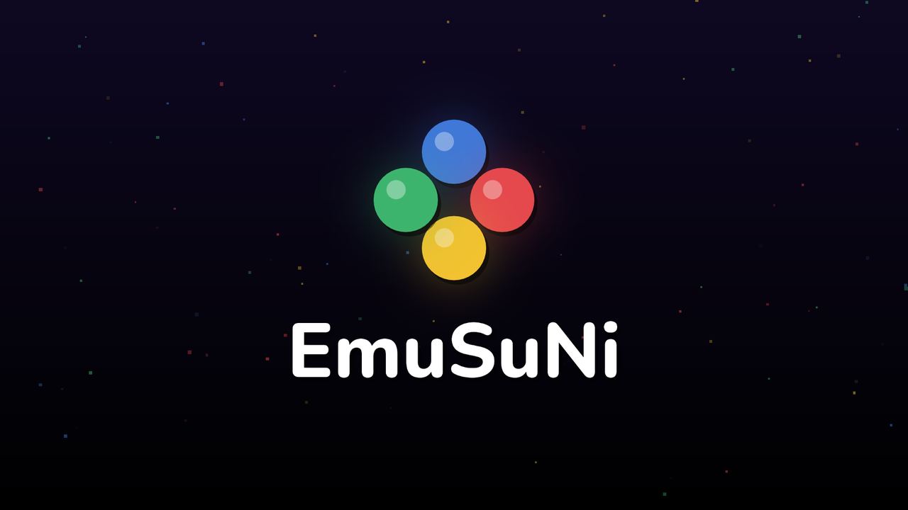
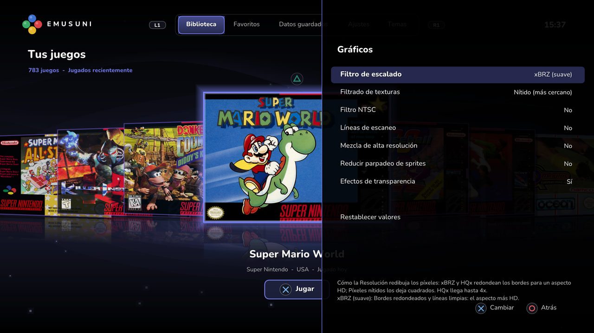

<p align="center">
  
</p>

<p align="center">
  <b>Super Nintendo, NES and Nintendo 64 for jailbroken PS4 consoles.</b><br>
  Three consoles in a console-style launcher: automatic box art, AI-enhanced HD picture, quality
  levels, bezels, favorites, search, and settings for every game.
</p>

<p align="center">
  <a href="https://github.com/arturofuentes1988/EmuSuNi/releases/latest"></a>
  
  
  <a href="LICENSE"></a>
</p>

<p align="center"><a href="README.es.md">Leer en español</a> · <a href="CHANGELOG.md">Changelog</a> · <a href="https://github.com/arturofuentes1988/EmuSuNi/releases/latest">Download</a></p>

---

## Screenshots

<table>
  <tr>
    <td width="50%"></td>
    <td width="50%"></td>
  </tr>
  <tr>
    <td align="center"><b>Library</b> — your games as box art, downloaded automatically</td>
    <td align="center"><b>In game</b> — redrawn at 5x (1080p) with the xBRZ filter</td>
  </tr>
  <tr>
    <td></td>
    <td></td>
  </tr>
  <tr>
    <td align="center"><b>Favorites</b> — L2 on any game</td>
    <td align="center"><b>Search</b> — an on-screen keyboard, results as you type</td>
  </tr>
  <tr>
    <td></td>
    <td></td>
  </tr>
  <tr>
    <td align="center"><b>Settings</b> — every option explained at the bottom</td>
    <td align="center"><b>In-game menu</b> (L3 + R3) — save states, settings, cheats</td>
  </tr>
  <tr>
    <td></td>
    <td></td>
  </tr>
  <tr>
    <td align="center"><b>XMB style</b> — the PSP-style columns, 12 colour themes</td>
    <td align="center"><b>Clean Up Games</b> — duplicates and other regions</td>
  </tr>
</table>

<details>
<summary>More screenshots</summary>

| | |
|---|---|
|  |  |
| Start-up animation | A game's options (Triangle) |
|  | |
| Graphics settings: the upscaling filters | |

</details>

## Features

**Emulation**
- **Snes9x 1.63**, the libretro build, linked into the app, with the SuperFX, SA-1, DSP and other
  cartridge chips, hi-res and interlaced modes.
- Battery saves written automatically, **8 save-state slots** with screenshots, *resume where you
  left off*, RetroArch `.cht` **cheats**, the console's reset button.
- **Up to 5 players** with the Super Multitap and more DualShock 4 controllers.

**A launcher like a console's**
- Two menu styles: **Library** (box art in a row, tabs on L1 / R1) and **XMB** (the PSP-style
  columns), 12 colour themes or your own wallpapers, 8-bit sound effects and intro jingle.
- **Box art, automatically**: missing covers download in the background from libretro's
  thumbnail server. GoodSNES and No-Intro names both match (Roman numerals, subtitles, word order,
  close spellings); a title screen is used when a game has no box.
- **Favorites** tab, **search** with an on-screen keyboard, sorting (A–Z, recently played,
  region), a default game that starts by itself.
- **Game management**: a folder browser for internal storage or USB drives, *delete a game*,
  *Clean Up Games* (delete duplicates, keep only USA games — everything is listed first).
- **13 languages**: English, Español, Français, Deutsch, Italiano, Português, Nederlands, Polski,
  Türkçe, Русский, 日本語, 中文, 한국어.

**Picture**
- **Resolution** 2x–6x (**5x for 1080p**) with the **xBRZ**, **HQx** or **Sharp Pixels**
  upscaling filters, multithreaded (3–6 ms per frame at 6x, measured on a PS4).
- Aspect ratio (4:3, pixel-perfect 8:7, 16:9, stretch), integer scaling, zoom, overscan crop,
  sharp or smooth filtering, scanlines, blargg's **NTSC filter** (composite, S-Video, RGB, RF),
  hi-res blending, reduced sprite flicker, V-Sync.

**Performance and system**
- CPU and SuperFX overclocking, emulation speed, **fast forward** (R2), frame skip, FPS counter
  and performance graphs.
- Audio interpolation (Gaussian like the console, cubic, sinc...), audio buffer, volume.
- **Every setting for all games or for one game**, with a short description of each setting and
  each of its options.
- **Button remapping**, for all games or one game.

## Requirements

- A PS4 with **[GoldHEN](https://github.com/GoldHEN/GoldHEN)** (any model).
- Your own games:
  - Super Nintendo: `.sfc`, `.smc`, `.swc`, `.fig`, `.bs` or `.zip`.
  - NES: `.nes`, `.fds`, `.unf` or `.zip`.
  - Nintendo 64: `.z64`, `.n64` or `.v64` (on the USB drive, folder `Roms/n64`; it can be changed).
- Internet on the PS4 for the box art (optional).

## Installation

1. Download **`EmuSuNi-vXX.YY.pkg`** from the [latest release](https://github.com/arturofuentes1988/EmuSuNi/releases/latest).
2. Copy it to a USB drive (FAT32 or exFAT), for example in a `PKG` folder.
3. On the PS4, install it with GoldHEN's **Package Installer** (or *Settings → Debug Settings →
   Game → Package Installer*).
4. Start **EmuSuNi** from the home screen.

To update, install the new package over the old one: your settings, saves and covers stay in
`/data/EmuSuNi`.

## Getting started

1. Put your games in `/data/EmuSuNi/games` (FTP), or anywhere on a USB drive — then choose that
   folder in **Settings → Game Folder**. Subfolders are searched too.
2. The covers download by themselves the first time (the progress shows under *Your games*).
3. Press **Cross** to play. In a game, **L3 + R3** (both sticks pressed) opens the menu.

## Controls

| Menu (Library style) | |
|---|---|
| D-Pad Left / Right | Previous / next game (Up / Down: 10 at a time) |
| L1 / R1 | Tabs: Library, Favorites, Saved Data, Settings, Themes |
| Cross | Play / select |
| Triangle | Game options: favorite, settings, cheats, controls, information, default game, delete |
| L2 | Add to / remove from Favorites |
| R2 | Search (on-screen keyboard) |
| Square | Read the game folder again |
| Options | Sort: A–Z, recently played, region |
| Circle | Back (in a search: clear it) |

| Search keyboard | |
|---|---|
| Cross | Type the key |
| Square / Triangle | Delete a letter / space |
| L2 | Clear everything |
| L1 / R1 | Go through the games found without leaving the keyboard |
| R2 | Done |
| Circle | Close the keyboard |

| In game (default layout) | |
|---|---|
| Cross / Circle / Square / Triangle | SNES B / A / Y / X |
| L1 / R1 | SNES L / R |
| Options / Touchpad | Start / Select |
| D-Pad or left stick | D-Pad |
| R2 (hold) | Fast forward |
| L3 + R3 | In-game menu |

Hold **L1** while EmuSuNi starts to open the menu instead of the default game.

## Settings

Every setting can apply to **all games** or to **one game** (*Apply To* at the top of a game's
settings; *Use for All Games* copies one game's settings to every game). Under each list, a short
text explains the selected setting and what its current option does.

| Category | Settings |
|---|---|
| **Video** | Aspect Ratio · **Resolution** (Native, 2x–6x) · Picture Size · Letterbox Zoom · Crop Overscan · Frame Rate Limit · V-Sync · FPS Counter |
| **Graphics** | **Upscaling Filter** (xBRZ, HQx, Sharp Pixels) · Texture Filtering · NTSC Filter · Scanlines · Hi-Res Blending · Reduce Sprite Flicker · Transparency Effects |
| **Performance** | Emulated CPU Clock · SuperFX Clock · Emulation Speed · Fast Forward · Frame Skip · Performance Graphs |
| **Emulation** | Region · Block Invalid VRAM Access · Echo Buffer Hack · Allow Opposing Directions · Randomize Memory |
| **System** | Language · Game Volume · Audio Interpolation · Audio Buffer · Multitap · Resume Where You Left Off |

## Files on the PS4

Everything lives in `/data/EmuSuNi` (reachable by FTP with GoldHEN):

| Path | Contents |
|---|---|
| `games/` | The default game folder |
| `covers/` | Box art: `<game file name>.png` or `<title>.png` — your own pictures work too |
| `saves/`, `states/` | Battery saves and save states (with their screenshots) |
| `cheats/` | Cheats: `<game file name>.cht` (RetroArch format) |
| `themes/` | Wallpapers (PNG, 1920×1080) and sounds that replace the built-in ones |
| `settings.ini`, `controls.ini`, `xmb.ini`, `favorites.ini` | Your settings |
| `emusuni.log` | The log, for bug reports |

## Building from source

The build runs on **Ubuntu 24.04** (WSL2 works) with clang 21, PacBrew's OpenOrbis toolchain and
DolphinPS4's PS4 runtime (libc++ 21 and Mesa's RADV Vulkan driver).

```sh
# once: packages, toolchain, libc++, Mesa, Snes9x and Dear ImGui (as root, ~45 minutes)
sudo -i bash /path/to/EmuSuNi/scripts/setup.sh

# then
EMUSUNI_VERSION=00.18 bash scripts/build.sh   # builds ~/emusuni-build/emusuni_eboot/eboot.bin
bash scripts/package.sh 00.18                 # makes the .pkg in ~/emusuni-build/out
```

`scripts/make-assets.py` regenerates the icon, the start-up pictures, the logo and the 8-bit
sounds (Python + Pillow); `scripts/make-lang.py` the language files.

<details>
<summary>Under the hood</summary>

- **Display**: Vulkan through Mesa's RADV driver running on the PS4's GNM interface (from
  DolphinPS4), three 1920×1080 VideoOut buffers. The menus are drawn with Dear ImGui.
- **Identity**: the package uses the plain homebrew identity (PAID `0x3800000000000035`), which
  RADV needs for its GPU memory; a system identity makes `vkCreateDevice` hang.
- **Memory**: the PS4's system C library serves allocations from a ~12 MiB pool shared with the
  kernel's own objects. All of the app's allocations — C `malloc` and C++ `new` — go to a
  dlmalloc heap in system flexible memory instead (`port/`).
- **Upscaling**: Snes9x's xBRZ and HQx filters run in five slices of rows on four worker threads
  plus the emulator's; the result is uploaded as an RGB565 texture.
- **Covers**: libretro's thumbnail server over plain HTTP (the PS4's TLS fails on GitHub's
  servers), with GitHub as a fallback; pictures are shrunk to the size the menu shows.

</details>

## Credits

- **[Snes9x](https://github.com/snes9xgit/snes9x)** (Super Nintendo),
  **[FCEUmm](https://github.com/libretro/libretro-fceumm)** (NES) and
  **[Mupen64Plus-Next](https://github.com/libretro/mupen64plus-libretro-nx)** with ParaLLEl-RDP and
  ParaLLEl-RSP (Nintendo 64) — the emulators.
- **[Anime4K](https://github.com/bloc97/Anime4K)** and **AMD FidelityFX Super Resolution** — the
  AI-enhanced HD picture and the smooth upscaling.
- **[DolphinPS4](https://github.com/iHaiDeeZ/DolphinPS4)** — the launcher's design, the PS4
  runtime, the Mesa port and the build setup that EmuSuNi grew from.
- **[Dear ImGui](https://github.com/ocornut/imgui)**, **[Mesa](https://mesa3d.org)**,
  **[OpenOrbis](https://github.com/OpenOrbis) / [PacBrew](https://github.com/PacBrew)**,
  **[libretro-thumbnails](https://github.com/libretro-thumbnails)**, xBRZ, HQx, blargg's NTSC
  filter, and the fonts' authors. See [THIRD_PARTY_NOTICES.md](THIRD_PARTY_NOTICES.md).

EmuSuNi by [@arturofuentes1988](https://github.com/arturofuentes1988).

## License and legal

EmuSuNi's own code is licensed under the **GNU GPL v2 or later** ([LICENSE](LICENSE)). Snes9x is
under its own license, which allows free, **non-commercial** use only; the EmuSuNi packages are
free builds. Other components keep their licenses ([THIRD_PARTY_NOTICES.md](THIRD_PARTY_NOTICES.md)).

**No games are included.** Use games you own. EmuSuNi is not affiliated with or endorsed by
Nintendo or Sony. *Super Nintendo*, *Super Famicom*, *SNES*, *NES* and *Nintendo 64* are trademarks of Nintendo;
*PlayStation* and *PS4* are trademarks of Sony Interactive Entertainment.
