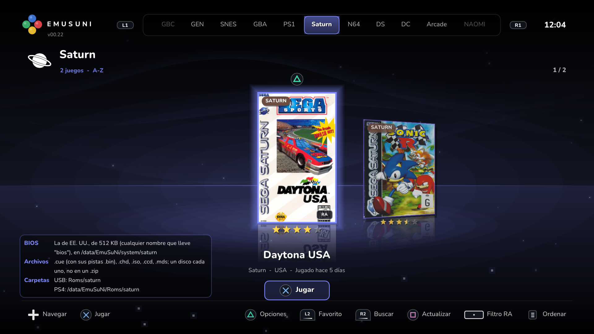
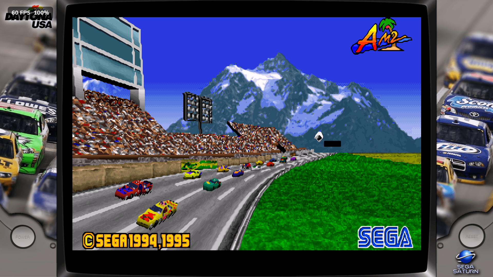
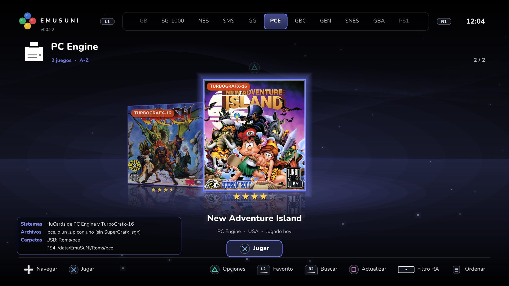
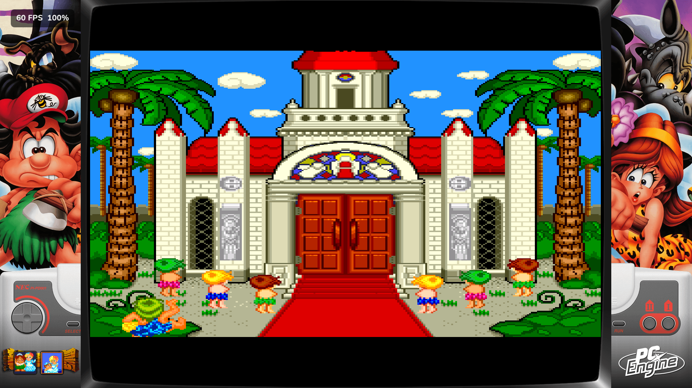
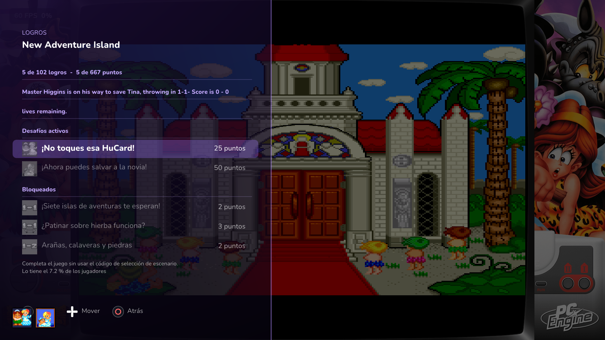
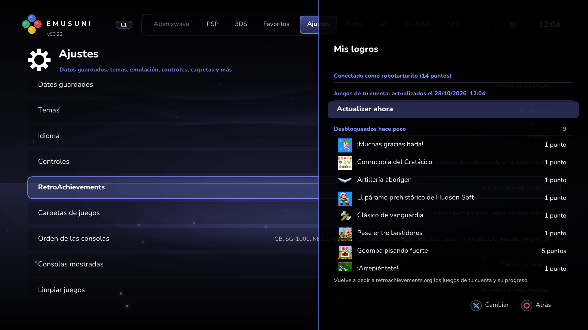
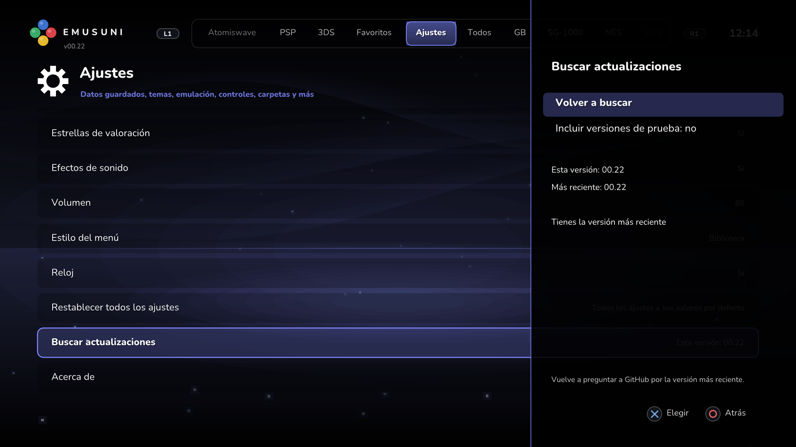

<p align="center">
  
</p>

<p align="center">
  <b>Twenty classic consoles and arcade boards in one app for jailbroken PS4 consoles.</b><br>
  Super Nintendo · NES · Nintendo 64 · Game Boy · Game Boy Color · Game Boy Advance · PlayStation ·
  Nintendo DS · Nintendo 3DS · PSP · Dreamcast · NAOMI · Atomiswave · SG-1000 · Master System ·
  Game Gear · Genesis · Saturn · PC Engine · Arcade
</p>

<p align="center">
  A launcher that feels like a console's own: your games with their box art, an AI-enhanced HD
  picture, cheats from the internet, RetroAchievements, save states, bezels and settings for every game.
</p>

<p align="center">
  <a href="https://github.com/arturofuentes1988/EmuSuNi/releases/latest"></a>
  
  
  <a href="LICENSE"></a>
</p>

<p align="center"><a href="README.es.md">Leer en español</a> · <a href="CHANGELOG.md">Changelog</a> · <a href="https://github.com/arturofuentes1988/EmuSuNi/releases/latest">Download</a> · <a href="https://t.me/+5Y2CVb3aR500OGMx">Telegram</a></p>

---

## Quick start

1. **Install**: download `EmuSuNi-vXX.YY.pkg` from the [latest release](https://github.com/arturofuentes1988/EmuSuNi/releases/latest),
   copy it to a USB drive and install it with GoldHEN's **Package Installer** ([Installation](#installation)).
   **To update**: from v00.22 on, the app tells you when a new version is out and **Settings → Check for
   Updates** installs it; or install the new package over the old one (your games, saves and settings
   stay). From v00.21, install v00.22 by hand this once.
2. **Add your games**: copy them to `Roms/<console>` on the USB drive or to `/data/EmuSuNi/Roms/<console>`
   on the PS4 (by FTP). The app makes the folders itself: `snes`, `nes`, `n64`, `gb`, `gbc`, `gba`, `ps1`,
   `nds`, `3ds`, `psp`, `dc`, `naomi`, `atomiswave`, `sg1000`, `sms`, `gg`, `md` (Genesis), `saturn`,
   `pce` (PC Engine) and `arcade`.
   Arcade, NAOMI and Atomiswave games stay in their `.zip` ([formats](#the-consoles)).
3. **BIOS**: only the Arcade's Neo Geo games (`neogeo.zip`), NAOMI (`naomi.zip`, `naomi2.zip`),
   Atomiswave (`awbios.zip`) and the Saturn (a 512 KB `.bin`, such as `saturn_bios.bin`) need yours, plus
   `disksys.rom` for Famicom Disk System games ([BIOS files](#bios-files)). No games or BIOS files are
   included.
4. **Play**: your games show up by themselves, with their box art when the PS4 is online. In a game,
   **L3 + R3** opens the menu: save states, settings, controls, quit.
5. **Help and bug reports**: the [Telegram group](https://t.me/+5Y2CVb3aR500OGMx), or an
   [issue](https://github.com/arturofuentes1988/EmuSuNi/issues) with your `/data/EmuSuNi/emusuni.log`.

## The consoles

| Console | Emulator | Formats | BIOS |
|---|---|---|---|
| **Super Nintendo** | Snes9x 1.63 | `.sfc` `.smc` `.swc` `.fig` `.bs` | Not needed |
| **NES** and Famicom Disk System | FCEUmm | `.nes` `.fds` `.unf` `.unif` | Not needed |
| **Nintendo 64** | Mupen64Plus-Next | `.z64` `.n64` `.v64` | Not needed |
| **Game Boy** and **Game Boy Color** | mGBA | `.gb` `.sgb` `.dmg` `.gbc` `.cgb` | Not needed |
| **Game Boy Advance** | mGBA | `.gba` `.agb` | Not needed |
| **PlayStation** | SwanStation | `.cue` `.bin` `.chd` `.pbp` `.m3u` `.iso` `.img` `.ecm` `.mds` | Not needed |
| **Nintendo DS** | melonDS DS 1.4.0 | `.nds` `.ids` | Not needed |
| **Nintendo 3DS** — *experimental* | Azahar 2126.2 | Decrypted `.3ds` `.cci` `.cxi` `.3dsx` | Not needed |
| **PSP** | PPSSPP 1.20.4 | `.iso` `.cso` `.chd` `.pbp` `.elf` | Not needed |
| **Dreamcast** | Flycast 2.7 | `.gdi` `.cdi` `.chd` `.cue` `.m3u` | Not needed |
| **NAOMI** and NAOMI 2 | Flycast 2.7 | MAME sets `.zip` `.7z`, images `.dat` `.bin` | **Yours**: `naomi.zip`, `naomi2.zip` |
| **Atomiswave** | Flycast 2.7 | MAME sets `.zip` `.7z` | **Yours**: `awbios.zip` |
| **SG-1000** and SC-3000 | Genesis Plus GX | `.sg` `.sc` | Not needed |
| **Master System** | Genesis Plus GX | `.sms` `.bms` | Not needed |
| **Game Gear** | Genesis Plus GX | `.gg` | Not needed |
| **Genesis** / Mega Drive | Genesis Plus GX | `.md` `.gen` `.smd` `.bin` `.mdx` `.68k` `.sgd` | Not needed |
| **Saturn** — *experimental, new* | YabaSanshiro 3.4.2 | `.cue` `.chd` `.iso` `.ccd` `.mds` | **Yours**: a 512 KB `.bin` ([BIOS](#bios-files)) |
| **PC Engine** / TurboGrafx-16 — *new* | Beetle PCE Fast | `.pce` (HuCards) | Not needed |
| **Arcade**: Neo Geo, Capcom CPS1/CPS2/CPS3, Sega, Konami, Taito... | FinalBurn Neo 1.0.0.03 | One `.zip` / `.7z` per game, not unpacked | Neo Geo: **yours**, `neogeo.zip` |

No BIOS files or games are included. Only the Arcade's Neo Geo games, NAOMI, Atomiswave and the Saturn
need a BIOS of yours ([BIOS](#bios-files)).

The **Saturn** is experimental: it draws in software, on threads of its own, and its games can run slower
than on the console. The **Nintendo 3DS** is still experimental: decrypted games only; if a game doesn't
load the first time, **L3 + R3 → Reset Game** until it does. The PC Engine plays HuCards (no CD games).

## What's new in 00.22

- **Two new consoles**: the **Sega Saturn** (experimental) and the **PC Engine / TurboGrafx-16**.
- **RetroAchievements** (Casual) on every console but the 3DS: log in at **Settings → RetroAchievements**;
  **Triangle → Achievements** shows a game's achievements; an "RA" mark on the covers of the games that
  have them, and the **touchpad** shows only those; **My Achievements**; their texts translated into the
  app's language.
- **Updates from the app**: **Settings → Check for Updates** says when a new version is out, downloads it
  and hands it to the PS4's installer. Coming from v00.21, install v00.22 by hand this once.
- **Star ratings** under the covers (the players of the LaunchBox Games Database), and **a bezel for each
  game** from The Bezel Project (**Settings → Game Bezels** downloads the ones of your games).
- **DS and 3DS screens with the same settings**: Screen Layout (one above the other, side by side, large
  screen + small, one screen), Swap Screens, the small screen's size and position, the gap between them.
- **Quality levels** on the Dreamcast, NAOMI and Atomiswave (up to 3x) and on the 3DS (up to 4x); on every
  console each level is now clearly sharper than the one below.
- **Faster**: the Dreamcast, NAOMI and Atomiswave, the Saturn, the 3DS (fewer stops to compile its shaders
  and code) and the N64. The sound keeps its pitch when a game runs below full speed.
- **Fixes**: the PSP no longer runs too fast with Frame Skip (God of War); PlayStation `.bin` files without
  their `.cue`, 2048-byte-sector ISOs and LibCrypt discs start; the N64's Cruis'n USA, Resident Evil 2 and
  World Driver Championship no longer stay black, and Ultra draws no more lines over its 2D; automatic
  settings for the 3DS graphics errors of Pokémon X and Y, Majora's Mask 3D, Metroid: Samus Returns and
  Castlevania: Mirror of Fate.
- **Covers**: the Super Nintendo's in `covers/snes`, JPEG and any size; numbered file names (`01 Comix
  Zone`) get theirs; **Games Without Cover** says why a picture isn't used.
- **The emulators' own lists of special settings for some games** are applied (the log says which).
- **A game that doesn't open the first time is started again by itself.**
- **One keyboard for every text** (rename, search, login) with the menu's buttons; every menu goes round;
  **L1 / R1 held** go through the consoles; the in-game menu can also open with R3 or the touchpad held,
  Options + touchpad, or L1 + R1 or L2 + R2 held (**Settings → Controls → In-Game Menu**); PSP stick dead
  zone and sensitivity.
- Every console starts at Quality Low, Aspect Ratio Auto and its own bezel.

All the details: the [release notes](https://github.com/arturofuentes1988/EmuSuNi/releases/latest) and the [changelog](CHANGELOG.md).

## Screenshots

New in 00.22 (the app in Spanish):

<table>
  <tr>
    <td width="50%"></td>
    <td width="50%"></td>
  </tr>
  <tr>
    <td align="center"><b>Sega Saturn</b> (experimental) — covers, star ratings and the RA mark</td>
    <td align="center"><b>Daytona USA</b> — with its own bezel from The Bezel Project</td>
  </tr>
  <tr>
    <td></td>
    <td></td>
  </tr>
  <tr>
    <td align="center"><b>PC Engine / TurboGrafx-16</b> — HuCards</td>
    <td align="center"><b>New Adventure Island</b> — with its own bezel</td>
  </tr>
  <tr>
    <td></td>
    <td></td>
  </tr>
  <tr>
    <td align="center"><b>RetroAchievements</b> in the in-game menu (L3 + R3) — translated to Spanish</td>
    <td align="center"><b>My Achievements</b> — your latest unlocks and games</td>
  </tr>
  <tr>
    <td></td>
    <td></td>
  </tr>
  <tr>
    <td align="center"><b>Check for Updates</b> — the app tells you about each new version</td>
    <td></td>
  </tr>
</table>

Earlier versions:

<table>
  <tr>
    <td width="50%"></td>
    <td width="50%"></td>
  </tr>
  <tr>
    <td align="center"><b>Super Nintendo</b> — redrawn with AI (xBRZ + Anime4K)</td>
    <td align="center"><b>Nintendo 64</b> — at 4x, about Full HD</td>
  </tr>
  <tr>
    <td></td>
    <td></td>
  </tr>
  <tr>
    <td align="center"><b>Game Boy</b> — in the console's own bezel</td>
    <td align="center"><b>Game Boy Advance</b> — in its Indigo bezel</td>
  </tr>
  <tr>
    <td></td>
    <td></td>
  </tr>
  <tr>
    <td align="center"><b>Game Boy Color</b> — in its Berry bezel</td>
    <td align="center"><b>NES</b> — in the retro TV bezel</td>
  </tr>
  <tr>
    <td></td>
    <td></td>
  </tr>
  <tr>
    <td align="center"><b>Library</b> — a tab per console, box art downloaded automatically</td>
    <td align="center"><b>XMB style</b> — the PSP-style columns, 12 colour themes</td>
  </tr>
  <tr>
    <td></td>
    <td></td>
  </tr>
  <tr>
    <td align="center"><b>Quality</b> — Low, Medium, High or Ultra at once</td>
    <td align="center"><b>In-game menu</b> (L3 + R3) — save states, settings, cheats</td>
  </tr>
</table>

<details>
<summary>More screenshots</summary>

| | |
|---|---|
|  |  |
| Game Boy as the Super Game Boy: its colours and border | Mario Kart 64 at 4x |
|  |  |
| Super Nintendo tab | NES tab |
|  |  |
| Nintendo 64 tab | Game Boy tab |
|  |  |
| Game Boy Color tab | Game Boy Advance tab |
|  |  |
| Favorites (L2 on a game) | Search with an on-screen keyboard |
|  |  |
| A game's options (Triangle) | Clean Up Games: duplicates and other regions |

</details>

## Features

**Picture**
- **Quality** in one setting: Low, Medium, High or **Ultra** (the most each console can do), each
  level clearly sharper than the one below. Low is the console's own picture; on the 2D consoles
  Medium, High and Ultra are Smooth Edges, Pixel Art HD (xBRZ) and AI (xBRZ + Anime4K), on the 3D
  ones a bigger picture with smooth edges, sharpened at Ultra.
- **GPU Upscaler**: Smooth Edges (MMPX and SMAA), Natural HD (AMD FSR), Natural AI (the Anime4K
  neural network, without the waxy look), Pixel Art HD (xBRZ), AI (xBRZ + Anime4K), Smooth HD and
  HD Sharpen, at the TV's resolution.
- **HD 3D**: the Nintendo 64, the PlayStation and the PSP up to 4x (the PSP with texture upscaling),
  the Dreamcast, NAOMI and Atomiswave up to 3x, the 3DS up to 4x.
- **Resolution** 2x–6x with xBRZ, HQx or Sharp Pixels; aspect ratio, integer scaling, zoom,
  scanlines (on the Game Boys, the grid of their screen), NTSC filter, V-Sync.
- **Bezels for every console**: its own console's frame, a retro TV and six shared frames (arcade
  cabinet, dark minimal, neon, wood, carbon, starfield), your own, or **a bezel for each game** from
  [The Bezel Project](https://github.com/thebezelproject) (**Settings → Game Bezels** downloads the
  ones of your games). **Tube TV (CRT)**: curved glass, scanlines and a phosphor mask, in four looks.
- **DS and 3DS screens**: one above the other, side by side, a large screen and a small one, or one
  screen; swapped, with a gap, the small one where you want it.

**Playing**
- Battery saves written automatically, **8 save-state slots** with screenshots, *resume where you
  left off*, reset.
- **[RetroAchievements](https://retroachievements.org)** (Casual) on every console but the 3DS: log in
  at **Settings → RetroAchievements**, unlock achievements as you play, see a game's with
  **Triangle → Achievements** and yours in **My Achievements**; an "RA" mark on the covers of the
  games that have them; the achievements' texts translated into the app's language.
- **Cheats**: RetroArch `.cht` files, or **Find Cheats Online** (not on the Dreamcast, NAOMI,
  Atomiswave, Arcade or 3DS, whose emulators take no cheat codes here).
- **Games on several discs** grouped by themselves, with **Disc** in the in-game menu.
- **The in-game menu** (L3 + R3, or other buttons of your choice): save and load states, change the
  disc, settings, cheats, achievements, reset, quit.
- Up to 5 DualShock 4 controllers, rumble, fast forward.
- A game that doesn't open the first time is started again by itself.

**A launcher like a console's**
- Two menu styles: **Library** (box art in a row, a tab per console on L1 / R1, going round) and
  **XMB** (the PSP-style columns), 12 colour themes or your own wallpapers, 8-bit sounds.
- **Box art, automatically** from libretro's thumbnail server, and **star ratings** under them (the
  players of the [LaunchBox Games Database](https://gamesdb.launchbox-app.com)).
- **Updates from the app**: **Settings → Check for Updates** says when a new version is out,
  downloads it and hands it to the PS4's installer.
- **Console Order**: the consoles in the order you like, or By Company, By Power, By Year or
  Alphabetical.
- Favorites, search, sorting (A–Z, recently played, region, console), a default game, a folder
  browser, *Clean Up Games* and **13 languages** (complete in English and Spanish, partial in the
  other 11).
- **Every setting for all games, for a console or for one game**, with a short explanation of each
  option, and **button remapping**.

## Requirements

- A PS4 with **[GoldHEN](https://github.com/GoldHEN/GoldHEN)** (any model).
- Your own games:

  | Console | Files |
  |---|---|
  | Super Nintendo | `.sfc` `.smc` `.swc` `.fig` `.bs` |
  | NES | `.nes` `.fds` `.unf` `.unif` |
  | Nintendo 64 | `.z64` `.n64` `.v64` |
  | Game Boy | `.gb` `.sgb` `.dmg` |
  | Game Boy Color | `.gbc` `.cgb` (and the `.gb` files you put in its folder, like Pokémon Yellow) |
  | Game Boy Advance | `.gba` `.agb` |
  | PlayStation | `.cue` (with its `.bin` tracks) or a `.bin` alone, `.chd` `.pbp` `.m3u` `.iso` `.img` `.ecm` `.mds` |
  | Nintendo DS | `.nds` `.ids` |
  | Nintendo 3DS (experimental) | Decrypted `.3ds` `.cci` `.cxi` `.3dsx` (no `.cia`) |
  | PSP | `.iso` `.cso` `.chd` `.pbp` `.elf` |
  | Dreamcast | `.gdi` (with its tracks) `.chd` `.cdi` `.cue` `.m3u` |
  | NAOMI / NAOMI 2 | MAME sets `.zip` `.7z`, not unpacked, or `.dat` `.bin` images |
  | Atomiswave | MAME sets `.zip` `.7z`, not unpacked |
  | SG-1000 / SC-3000 | `.sg` `.sc` |
  | Master System | `.sms` `.bms` |
  | Game Gear | `.gg` |
  | Genesis / Mega Drive | `.md` `.gen` `.smd` `.bin` `.mdx` `.68k` `.sgd` |
  | Saturn (experimental) | `.cue` (with its `.bin` tracks) `.chd` `.iso` `.ccd` `.mds` |
  | PC Engine / TurboGrafx-16 | `.pce` (HuCards) |
  | Arcade | FinalBurn Neo 1.0.0.03 sets: one `.zip` / `.7z` per game, not unpacked (`mslug.zip`) |

  The cartridge consoles (Super Nintendo to Game Boy Advance, SG-1000 to Genesis, PC Engine) take
  `.zip` files too; the disc consoles, the DS and the 3DS read their games as they are. An Arcade, NAOMI
  or Atomiswave game's `.zip` is the game itself: keep it zipped, with its set's name.
- Internet on the PS4 for the box art and the online cheats (optional).

## Installation

1. Download **`EmuSuNi-vXX.YY.pkg`** from the [latest release](https://github.com/arturofuentes1988/EmuSuNi/releases/latest).
2. Copy it to a USB drive (FAT32 or exFAT), for example in a `PKG` folder.
3. On the PS4, install it with GoldHEN's **Package Installer** (or *Settings → Debug Settings →
   Game → Package Installer*).
4. Start **EmuSuNi** from the home screen.

**To update**: from v00.22 on, the app checks once a day and tells you when a new version is out;
**Settings → Check for Updates** checks now, and **Update Now** downloads the package (to the USB
drive's `PKG` folder, or the PS4) and hands it to the PS4's installer (the installation shows in
*Notifications → Downloads*; close EmuSuNi so the PS4 can finish it). From v00.21, install v00.22 by
hand this once.

By hand, install the new package over the old one: your settings, saves, states and covers stay
in `/data/EmuSuNi`. If the Package Installer won't install it over the old one, delete EmuSuNi from
the home screen (**OPTIONS → Delete**) and install the new package: `/data/EmuSuNi` isn't touched, so
nothing is lost.

## Where the games go

The app makes a folder for every console by itself, on the PS4 and on the USB drive you use for games:

| Where | Path | Over FTP |
|---|---|---|
| USB drive | `Roms/<console>` at the drive's root | `/mnt/usb0/Roms/<console>` |
| The PS4 | `/data/EmuSuNi/Roms/<console>` | `/data/EmuSuNi/Roms/<console>` |

The folders: `snes`, `nes`, `n64`, `gb`, `gbc`, `gba`, `ps1`, `nds`, `3ds`, `psp`, `dc`, `naomi`,
`atomiswave`, `sg1000`, `sms`, `gg`, `md` (Genesis), `saturn`, `pce` (PC Engine) and `arcade`.

- Copy your games there (by FTP or with the USB drive on a PC): they show up by themselves. Press
  **Square** in the Library to look again right away.
- **Any folder works** too: **Settings → Game Folders** sets another one for a console.
- On the PS4's own storage letters' case matters: an arcade, NAOMI or Atomiswave zip must keep its
  set's name in small letters (`mslug.zip`, `mvsc2.zip`).
- Deleting or updating the app doesn't delete `/data/EmuSuNi`: your games, saves, covers and settings stay.

**Games on several discs** (PlayStation, Dreamcast) become one game by themselves when:
- their files sit side by side with the disc in their names: `Game (Disc 1).chd`, `Game (Disc 2).chd`
  (also `(CD2)`, `(Disk 2)`, `[Disc 2]`);
- each disc has a folder: `Game (Disc 1)/disc.gdi`, or `Game/Disc 1/disc.gdi`;
- or an `.m3u` file lists them.

In the game, **L3 + R3 → Disc** changes the disc (Left / Right to choose, Cross to put it in). The
next time, the game starts with the disc you played last.

## BIOS files

None are included. Only these need yours:

| Console | Files | Folder |
|---|---|---|
| Arcade: Neo Geo games | `neogeo.zip` | Beside the games (`Roms/arcade`) |
| NAOMI / NAOMI 2 | `naomi.zip`, `naomi2.zip` | Beside the games (`Roms/naomi`) or `/data/EmuSuNi/system/dc` |
| Atomiswave | `awbios.zip` | Beside the games (`Roms/atomiswave`) or `/data/EmuSuNi/system/dc` |
| Saturn | A 512 KB `.bin`: `saturn_bios.bin` or `mpr-17933.bin` (USA / Europe), `sega_101.bin` (Japan), or any `.bin` with "bios" in its name (a USA or Europe one is preferred) | `/data/EmuSuNi/system/saturn`, `/data/EmuSuNi/system` or beside the game (`Roms/saturn`) |
| Famicom Disk System | `disksys.rom` | `/data/EmuSuNi/system` |

The other consoles play without one, the PC Engine included. If you have the real ones, they are used: PlayStation
(`scph5501.bin` or another, more games work) and Nintendo DS (`bios7.bin`, `bios9.bin`, `firmware.bin`)
in `/data/EmuSuNi/system`, Dreamcast (`dc_boot.bin`) in `/data/EmuSuNi/system/dc`.

## Box art

- **Downloaded automatically** (the PS4 needs internet) from libretro's thumbnail server; the
  progress shows under *Your games*. *Settings → Download Covers* looks again.
- **Your own work too**: a PNG or JPEG named like the game's file or its title in
  `/data/EmuSuNi/covers/<console>`, the same folder names as the games' (`covers/snes`, `covers/nes`,
  `covers/md`...), or in `EmuSuNi/covers/<console>` on the USB drive. Any size: a big picture is made
  smaller as it is read. **Settings → Games Without Cover** says why a picture of yours isn't used.
- When one is missing, **Triangle → Find Cover** shows the closest ones to pick from.

## Controls

**L3 + R3** (both sticks pressed) opens the in-game menu on every console (**Settings → Controls →
In-Game Menu** adds R3 or the touchpad held, Options + touchpad, L1 + R1 or L2 + R2 held). Every button can be
changed from a game: **Triangle → Controls** (*Apply To*: This Game, or All Games, which is every
game of that console).

| DualShock 4 | Super Nintendo | NES | Nintendo 64 | Game Boy / Color | Game Boy Advance |
|---|---|---|---|---|---|
| Cross | B | B | A | B | B |
| Circle | A | A | C Down | A | A |
| Square | Y | Turbo B | B | Turbo B | Turbo B |
| Triangle | X | Turbo A | C Up | Turbo A | Turbo A |
| L1 / R1 | L / R | Disk side / insert or eject (FDS) | L / R | — | L / R |
| L2 | — | — | Z | — | — |
| R2 | Fast forward | Fast forward | Z | Fast forward | Fast forward |
| Options | Start | Start | Start | Start | Start |
| Touchpad | Select | Select | Fast forward | Select | Select |
| Left stick | D-Pad | D-Pad | Stick | D-Pad | D-Pad |
| Right stick | — | — | C buttons | Tilt sensor | Tilt sensor |

| DualShock 4 | PlayStation | Nintendo DS | PSP | Dreamcast |
|---|---|---|---|---|
| Cross | Cross | B | Cross | A |
| Circle | Circle | A | Circle | B |
| Square | Square | Y | Square | X |
| Triangle | Triangle | X | Triangle | Y |
| L1 / R1 | L1 / R1 | L / R | L / R | — |
| L2 | L2 | Select | — | L trigger (analog) |
| R2 | R2 | Fast forward | Fast forward | R trigger (analog) |
| L3 / R3 | L3 / R3 | Microphone (blow) / swap screens | — | — |
| Options | Start | Start | Start | Start |
| Touchpad | Select | Touch screen | Select | — |
| Left stick | Left stick | D-Pad | Stick | Stick |
| Right stick | Right stick | — | — | — |

| DualShock 4 | Saturn | PC Engine |
|---|---|---|
| Cross | B | II |
| Circle | C | I |
| Square | A | III (6-button pad) |
| Triangle | Y | IV (6-button pad) |
| L1 / R1 | X / Z | V / VI (6-button pad) |
| L2 | L | — |
| R2 | R | Fast forward |
| Options | Start | Run |
| Touchpad | Fast forward | Select |
| Left stick | D-Pad | D-Pad |

| Menu (Library style) | |
|---|---|
| D-Pad Left / Right | Previous / next game (Up / Down: 10 at a time) |
| L1 / R1 | Tabs: All, each console, Favorites, Settings (held: through them) |
| Cross | Play |
| Triangle | Game options: favorite, game settings, cheats, controls, rename, find cover, achievements, information, default game, delete |
| L2 / R2 | Favorite / search |
| Square | Look for the games again |
| Touchpad | RetroAchievements filter: every game, the games with achievements, the ones in progress |
| Options | Sort |
| Circle | Back |

Hold **L1** while EmuSuNi starts to open the menu instead of the default game.

## Settings

**Settings** in the menu holds the app's own options: Themes, Language, Controls, RetroAchievements,
Game Folders, Console Order, Consoles Shown, Clean Up Games, Download Covers, Games Without Cover, Game
Bezels, Star Ratings, Sound Effects, Menu Style, Clock, Reset All Settings, Check for Updates...

A game's settings are set from the game: **Triangle → Game Settings** in the menu, or **Settings**
in the in-game menu. Each one can apply to **all games**, to **a console** or to **one game**
(*Apply To* at the top), and a short text under the list explains it and its current option.

| Category | Settings |
|---|---|
| **Video** | **Quality** (Low, Medium, High, Ultra) · Resolution · N64, PS1, PSP, Dreamcast and 3DS Resolution · Aspect Ratio · the DS's and the 3DS's Screen Layout, Swap Screens, Small Screen Size, Small Screen Position and Gap Between Screens · PS1 Widescreen · Picture Size · Letterbox Zoom · **Bezel** · Crop Overscan · Frame Rate Limit · V-Sync · FPS Counter |
| **Graphics** | Upscaling Filter · **GPU Upscaler** · Texture Filtering · the N64's anti-aliasing, dither filter, 2D, distant textures and screen effects · the PlayStation's geometry (PGXP), texture filtering, colours and anti-aliasing · the PSP's texture sharpness, texture upscaling and anti-aliasing · the Dreamcast's texture sharpness and transparency · NTSC Filter · Scanlines · **Tube TV (CRT)** · Hi-Res Blending · Reduce Sprite Flicker · Transparency Effects · **Game Boy Colours** · Screen Colours · LCD Ghosting |
| **Performance** | PSP Frame Rate (God of War) · 3DS CPU Clock · Dreamcast CPU Clock · Dreamcast Sound DSP · Emulated CPU Clock · SuperFX Clock · the N64's graphics sync, CPU cores, picture timing, CPU timing and frame pacing · PS1 Disc Speed · Emulation Speed · Fast Forward · Frame Skip · Performance Graphs |
| **Emulation** | Region · NES Palette · Turbo Buttons · the N64's CPU, RSP and Controller Pak · Boot Logo (BIOS) · Sunlight (Boktai) · Tilt Sensor · PS1 Controller · PS1 Boot Logo · PSP Stick Dead Zone and Sensitivity · DS and 3DS Touch Screen · New 3DS Mode · the 3DS's Accurate Shader Multiplication and Right Eye · PC Engine Pad · Allow Opposing Directions · Randomize Memory and more |
| **System** | Game Volume · Audio Interpolation · Sound Filter · Audio Buffer · Multitap (3-5 Players) · Resume Where You Left Off |

The Dreamcast's, NAOMI's and Atomiswave's games show only the settings that apply to them, Quality's
four levels among them (up to 3x).

## Files on the PS4

Everything lives in `/data/EmuSuNi` (reachable by FTP with GoldHEN):

| Path | Contents |
|---|---|
| `games/`, `nes/` | The Super Nintendo's and the NES's default game folders |
| `covers/` | Box art: a folder per console, named as the games' folders (`covers/snes`, `covers/nes`, `covers/md`...); PNG or JPEG |
| `saves/` | Battery saves and the cartridges' clocks (`.rtc`), the PlayStation's memory cards, the PSP's memory stick (`saves/psp`), the Dreamcast's VMUs (`saves/dc`), the Saturn's backup memory (`saves/saturn`) |
| `states/` | Save states |
| `cheats/` | Cheats: `<game file name>.cht` (RetroArch format), in its console's subfolder (`cheats/nes`, `cheats/ps1`...; the Super Nintendo's right in `cheats/`). If a game has no cheats yet, **Triangle → Cheats** shows the exact folder and name |
| `system/` | BIOS files (see [BIOS](#bios-files)) |
| `cache/` | The online cheat collection (kept a month), the lists of games on several discs, RetroAchievements' lists, pictures and translations, the star ratings, The Bezel Project's lists |
| `bezels/` | Your bezels: a 1920×1080 PNG, see-through where the game goes, in `bezels/<console>/`; the ones **Settings → Game Bezels** downloads go there too |
| `themes/` | Wallpapers (PNG, 1920×1080) and sounds that replace the built-in ones |
| `settings.ini`, `controls.ini`, `xmb.ini`, `favorites.ini` | Your settings |
| `retroachievements.ini` | Your RetroAchievements login (its token, never the password) |
| `emusuni.log` | The log, for bug reports (`emusuni-1.log` to `emusuni-4.log`: the sessions before) |

## Building from source

The build runs on **Ubuntu 24.04** (WSL2 works) with clang 21, PacBrew's OpenOrbis toolchain and
DolphinPS4's PS4 runtime (libc++ 21 and Mesa's RADV Vulkan driver).

```sh
# once: packages, toolchain, libc++, Mesa, every console's core and Dear ImGui (as root)
sudo -i bash /path/to/EmuSuNi/scripts/setup.sh

# then, as root too (setup.sh puts the sources and the PS4 runtime in root's home)
sudo -i
cd /path/to/EmuSuNi
EMUSUNI_VERSION=00.22 bash scripts/build.sh with-saturn   # builds ~/emusuni-build/emusuni_eboot/eboot.bin
bash scripts/package.sh 00.22                             # makes the .pkg in ~/emusuni-build/out
```

`scripts/build.sh` builds each core first (`scripts/build-*-core.sh`, again only what changed);
`no-n64`, `no-ps1`, `no-nds`, `no-psp`, `no-dc`, `no-sega`, `no-arcade`, `no-3ds` or `no-pce` leave a
console out, and `with-saturn` puts the Saturn in (the releases are built with it). `scripts/make-assets.py`
regenerates the icon, the start-up pictures, the logo and the 8-bit sounds (Python + Pillow);
`scripts/make-bezels.py` the bezels.

<details>
<summary>Under the hood</summary>

- **Display**: Vulkan through Mesa's RADV driver running on the PS4's GNM interface (from
  DolphinPS4), three 1920×1080 VideoOut buffers. The menus are drawn with Dear ImGui.
- **Cores**: every emulator is a libretro core linked into the app, its API renamed
  (`snes9x_retro_*`, `flycast_retro_*`...), so one process plays every console.
- **3D on the PS4's GPU**: the Nintendo 64 (ParaLLEl-RDP), the PlayStation, the PSP, the
  Dreamcast (with NAOMI and Atomiswave) and the 3DS draw with their own Vulkan renderers on the app's
  Vulkan device. The Saturn draws in software.
- **Threads**: the N64's RDP, the DS's 3D (on two threads), the PSP's and DS's drawing and the
  Saturn's VDP1 and VDP2 run beside the emulation, on cores of their own.
- **GPU filters**: xBRZ, MMPX, SMAA, Anime4K and AMD FSR/RCAS run as Vulkan fragment-shader passes
  before the menu is drawn; their pipelines are compiled in the background and cached.
- **Memory**: the PS4's system C library serves allocations from a ~12 MiB pool shared with the
  kernel's own objects. All of the app's allocations — C `malloc` and C++ `new` — go to a
  dlmalloc heap in system flexible memory instead (`port/`), behind a blocking lock (the PS4 runs
  threads by fixed priorities).
- **Covers**: libretro's thumbnail server over plain HTTP, with GitHub as a fallback; pictures are
  shrunk to the size the menu shows.

</details>

## Credits

- The emulators: **[Snes9x](https://github.com/snes9xgit/snes9x)** (Super Nintendo),
  **[FCEUmm](https://github.com/libretro/libretro-fceumm)** (NES),
  **[Mupen64Plus-Next](https://github.com/libretro/mupen64plus-libretro-nx)** with ParaLLEl-RDP and
  ParaLLEl-RSP (Nintendo 64), **[mGBA](https://mgba.io)** (Game Boy, Color and Advance),
  **[SwanStation](https://github.com/libretro/swanstation)**, based on
  [DuckStation](https://github.com/stenzek/duckstation) (PlayStation),
  **[melonDS DS](https://github.com/JesseTG/melonds-ds)**, based on
  [melonDS](https://melonds.kuribo64.net) (Nintendo DS), **[Azahar](https://azahar-emu.org)**
  (Nintendo 3DS), **[PPSSPP](https://www.ppsspp.org)** (PSP),
  **[Flycast](https://github.com/flyinghead/flycast)** (Dreamcast, NAOMI and Atomiswave; with parts of
  [Resonance](https://github.com/iHaiDeeZ/Resonance)'s fast memory),
  **[Genesis Plus GX](https://github.com/libretro/Genesis-Plus-GX)** (SG-1000, Master System, Game Gear
  and Genesis), **[YabaSanshiro](https://github.com/libretro/yabause/tree/yabasanshiro)** (Saturn),
  **[Beetle PCE Fast](https://github.com/libretro/beetle-pce-fast-libretro)**, based on
  [Mednafen](https://mednafen.github.io) (PC Engine) and **[FinalBurn Neo](https://github.com/finalburnneo/FBNeo)**
  (Arcade).
- **[RetroAchievements](https://retroachievements.org)** and its rcheevos library, the
  **[LaunchBox Games Database](https://gamesdb.launchbox-app.com)**'s ratings and
  **[The Bezel Project](https://github.com/thebezelproject)**'s bezels, downloaded by the app.
- **[Anime4K](https://github.com/bloc97/Anime4K)**, **AMD FidelityFX Super Resolution**,
  **[SMAA](https://github.com/iryoku/smaa)** and **MMPX** — the AI-enhanced HD picture, the smooth
  upscaling and the clean edges.
- **[DolphinPS4](https://github.com/iHaiDeeZ/DolphinPS4)** — the launcher's design, the PS4
  runtime, the Mesa port and the build setup that EmuSuNi grew from.
- **[Dear ImGui](https://github.com/ocornut/imgui)**, **[Mesa](https://mesa3d.org)**,
  **[OpenOrbis](https://github.com/OpenOrbis) / [PacBrew](https://github.com/PacBrew)**,
  **[libretro-thumbnails](https://github.com/libretro-thumbnails)**, libretro's cheat collection,
  xBRZ, HQx, blargg's NTSC filter, and the fonts' authors. See
  [THIRD_PARTY_NOTICES.md](THIRD_PARTY_NOTICES.md).

EmuSuNi by [@arturofuentes1988](https://github.com/arturofuentes1988).

## License and legal

EmuSuNi's own code is licensed under the **GNU GPL v2 or later** ([LICENSE](LICENSE)). Snes9x,
Genesis Plus GX and FinalBurn Neo are under their own licenses, which allow free, **non-commercial**
use only; the EmuSuNi packages are free builds, and EmuSuNi asks for no donations. The other emulators
and components keep their licenses ([THIRD_PARTY_NOTICES.md](THIRD_PARTY_NOTICES.md)).

**No games or BIOS files are included.** Use games you own. EmuSuNi is not affiliated with or
endorsed by Nintendo, Sony, Sega or any other maker of these consoles and games. *Super Nintendo*,
*Super Famicom*, *SNES*, *NES*, *Nintendo 64*, *Game Boy*, *Game Boy Color*, *Game Boy Advance*,
*Nintendo DS* and *Nintendo 3DS* are trademarks of Nintendo; *PlayStation*, *PSP* and *PS4* are
trademarks of Sony Interactive Entertainment; *Dreamcast*, *Saturn*, *Genesis*, *Mega Drive*, *Master
System*, *Game Gear* and *NAOMI* are trademarks of Sega; the other names are trademarks of their
owners.
